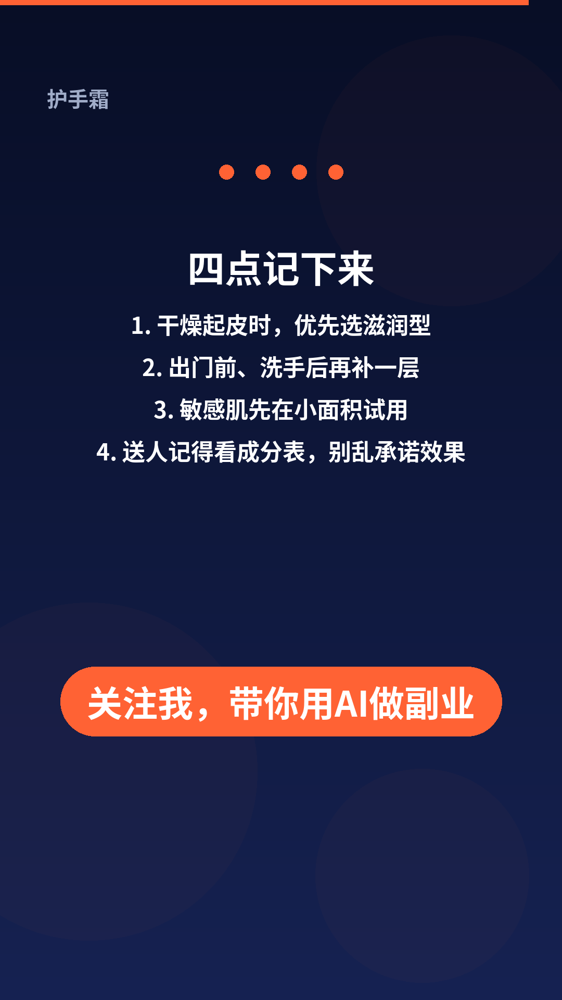

# AI文案短视频助手

输入一个产品名或主题，就能在自己的电脑上一次生成：

1. **4 种风格的小红书文案**（搞笑吐槽 / 温柔治愈 / 干货测评 / 送礼推荐，含标题、正文、emoji 和 5 个话题标签）
2. **15 秒竖屏短视频**（1080×1920，30 帧，H.264 + AAC 音频）
3. **一张封面 PNG**，可直接当笔记封面

默认用本地模板生成文案，**不需要 API Key，也不用联网**。视频由 Python 一帧一帧画出来，再用 ffmpeg 合成，不调用任何 AI 视频模型。背景节拍和「啵」的音效也是代码现场算出来的，没有使用受版权保护的音乐。

> 本工具只帮助你写出草稿、做出视频素材。它不能保证阅读量、点赞或收入，请根据真实体验改文案后再发布，也不要夸大产品效果。


---

## 效果预览

下面是「护手霜」示例的几个分镜（完整视频见 [`examples/护手霜/护手霜_15秒_竖屏.mp4`](examples/护手霜/护手霜_15秒_竖屏.mp4)，完整文案见 [`examples/护手霜/文案.md`](examples/护手霜/文案.md)）。

| 开头钩子 | 要点气泡（打字效果） | 结尾 |
| --- | --- | --- |
|  |  |  |

视频结构（可改时长和结尾句）：

- 0～约 2.2 秒：钩子句 + 橙色副标题
- 随后 4 个要点，各约 3 秒：聊天气泡打字效果
- 最后约 2.6 秒：回顾四点 + 结尾句（默认是「关注我，带你用AI做副业」，可自己改）

画面是深蓝背景、橙色点缀，带滑入和淡入动画。没有公司 Logo，也不模仿其他软件的界面。

---

## 你需要准备什么

一台 Windows 电脑（Mac / Linux 也可以，步骤类似）。需要先安装两样免费软件：

| 软件 | 做什么用 | 会不会很难 |
| --- | --- | --- |
| [Python 3.10 或更高版本](https://www.python.org/downloads/windows/) | 运行本工具 | 装好后勾选一个选项即可 |
| [ffmpeg](https://www.gyan.dev/ffmpeg/builds/) | 把图片和声音合成 mp4 视频 | 按下面步骤加到系统路径 |

中文字体：Windows 一般已经自带 **微软雅黑**（`C:\Windows\Fonts\msyh.ttc`），本工具会自动使用。如果你想用 Noto Sans CJK SC，可以把字体文件放到本项目的 `fonts` 文件夹，或运行时用 `--font` 指定路径。

---

## 安装步骤（Windows 小白版）

请按顺序做，做完一步再做下一步。

### 第 1 步：安装 Python

1. 打开 [Python 官方 Windows 下载页](https://www.python.org/downloads/windows/)，下载最新的 **Python 3** 安装包。
2. 双击安装包。**一定要勾选** 底部的 **“Add python.exe to PATH”**，然后再点 Install Now。
3. 安装完成后，按键盘 `Win` 键，输入 `cmd`，打开「命令提示符」。
4. 输入下面这一行，按回车。如果能看到 `Python 3.x.x`，就说明成功了：

```bat
python --version
```

如果提示“不是内部或外部命令”，多半是没勾选 Add to PATH。请卸载后重新安装，并勾上那个选项。

### 第 2 步：安装 ffmpeg

任选一种方式。

**方式 A（比较简单，适合 Windows 10/11）：**

1. 按 `Win` 键，输入 `PowerShell`，打开 Windows PowerShell。
2. 输入下面这一行，按回车：

```powershell
winget install ffmpeg
```

3. **关掉所有命令行窗口，再重新打开一个**，输入：

```bat
ffmpeg -version
```

能看到版本信息就成功了。

**方式 B（手动下载）：**

1. 打开 [ffmpeg Windows 构建页](https://www.gyan.dev/ffmpeg/builds/)，下载 “ffmpeg-git-essentials.7z” 或官网推荐的 release 压缩包。
2. 解压到一个好记的位置，例如 `C:\ffmpeg`。解压后里面应该有一个 `bin` 文件夹，其中有 `ffmpeg.exe`。
3. 把 `C:\ffmpeg\bin` 加到系统环境变量 Path：
   - 按 `Win` 键，搜索「环境变量」，打开「编辑系统环境变量」
   - 点「环境变量」→ 在「用户变量」或「系统变量」里找到 `Path` → 编辑 → 新建 → 粘贴 `C:\ffmpeg\bin` → 一路确定
4. **重新打开**命令提示符，输入 `ffmpeg -version` 检查。

### 第 3 步：下载本项目

如果你已经会用 Git：

```bat
git clone https://github.com/812822586-droid/ai-copy-video.git
cd ai-copy-video
```

如果还不会 Git：在本仓库页面点击绿色的 **Code** 按钮，选择 **Download ZIP**，解压到例如桌面，然后进入解压出来的 `ai-copy-video` 文件夹。

### 第 4 步：安装 Python 依赖

在 `ai-copy-video` 文件夹的地址栏里输入 `cmd` 再按回车（会在当前文件夹打开命令行），然后输入：

```bat
python -m pip install -r requirements.txt
```

只需要安装一次。依赖很少，只有 `pillow`（画画面）和 `numpy`（做音效）。

---

## 开始使用

### 方法一：双击运行（推荐）

直接双击项目里的 **`run.bat`**。

- 会提示你输入产品名或主题
- 直接回车，就会用「护手霜」做一次示例
- 生成结束后，窗口不要急着关，里面会告诉你文件保存在哪

### 方法二：命令行

在项目文件夹里打开命令提示符，输入：

```bat
python make.py --topic 护手霜
```

把 `护手霜` 换成你自己的产品名即可，例如：

```bat
python make.py --topic 无线耳机
python make.py --topic 秋季旅行
```

自定义四个要点（用竖线 `|` 分隔，不要用逗号，以免和中文逗号混在一起）：

```bat
python make.py --topic 护手霜 --points "干燥起皮时，优先选滋润型|出门前、洗手后再补一层|敏感肌先在小面积试用|送人记得看成分表，别乱承诺效果"
```

也可以连写 4 次 `--point`：

```bat
python make.py --topic 护手霜 --point "干燥起皮时，优先选滋润型" --point "出门前、洗手后再补一层" --point "敏感肌先在小面积试用" --point "送人记得看成分表，别乱承诺效果"
```

生成横屏 1920×1080 视频：

```bat
python make.py --topic 护手霜 --orientation landscape
```

改结尾句、钩子句，或指定字体：

```bat
python make.py --topic 护手霜 --hook "秋冬洗手后，手背又干又糙？" --sub "选护手霜，先看这四点" --outro "关注我，每天分享实用好物" --font C:\Windows\Fonts\msyh.ttc
```

只想先看文案和封面、暂时不渲染视频：

```bat
python make.py --topic 护手霜 --skip-video
```

---

## 生成结果在哪里

默认会生成到 `output/你的主题名/` 文件夹，例如 `output/护手霜/`：

```
output/护手霜/
  文案.md              ← 4 种风格文案，可复制到小红书草稿箱
  封面.png              ← 竖屏封面
  护手霜_15秒_竖屏.mp4   ← 15 秒视频
  frames/               ← 分镜预览图，方便检查文字有没有被切到
```

也可以用 `--outdir 文件夹路径` 指定保存位置。

---

## 常用参数

| 参数 | 含义 | 默认 |
| --- | --- | --- |
| `--topic` | 产品名或主题（必填） | 无 |
| `--points` | 四个要点，用 `\|` 分隔 | 按主题自动生成 |
| `--hook` | 开头钩子句 | 按主题自动生成 |
| `--sub` | 钩子下方的橙色副标题 | 按主题自动生成 |
| `--outro` | 结尾句 | 关注我，带你用AI做副业 |
| `--orientation` | `portrait` 竖屏 / `landscape` 横屏 | portrait |
| `--duration` | 视频秒数（5～60） | 15 |
| `--fps` | 帧率 | 30 |
| `--font` | 中文字体文件路径 | 自动寻找 |
| `--outdir` | 输出文件夹 | `output/主题名/` |
| `--use-ai` | 尝试用 AI 接口写文案 | 关闭（走本地模板） |
| `--skip-video` | 只出文案和封面 | 关闭 |

字体也可通过环境变量指定：`AICOPY_FONT` 或 `FONT_PATH`。

---

## 可选：用 AI 来写文案

不填这项也能用。如果你有 [DeepSeek](https://platform.deepseek.com/) 或其它 **OpenAI 兼容**接口的 API Key，可以让文案更灵活。失败时会自动退回本地模板，不会中断。

在命令行里先设置（不要把 Key 发给别人，也不要写进代码里提交到 GitHub）：

```bat
set DEEPSEEK_API_KEY=你的密钥
python make.py --topic 护手霜 --use-ai
```

也可以用 OpenAI 官方，或其它兼容服务：

```bat
set OPENAI_API_KEY=你的密钥
set OPENAI_BASE_URL=https://api.openai.com/v1
set OPENAI_MODEL=gpt-4o-mini
python make.py --topic 护手霜 --use-ai
```

对应的环境变量：`DEEPSEEK_API_KEY` / `DEEPSEEK_BASE_URL` / `DEEPSEEK_MODEL`，或 `OPENAI_API_KEY` / `OPENAI_BASE_URL` / `OPENAI_MODEL`。

---

## 常见问题

**1. 输入 `python` 提示不是内部或外部命令？**  
安装 Python 时没有勾选 “Add python.exe to PATH”。请重新安装并勾选。有的电脑要用 `py -3 make.py --topic 护手霜`。

**2. 提示找不到 ffmpeg？**  
说明 ffmpeg 还没装好，或命令行窗口是安装之前打开的。请按第 2 步装完后，**关掉窗口再开一个新的**，输入 `ffmpeg -version` 检查。文案和封面其实已经生成好了，装好 ffmpeg 再运行一次即可补出视频。

**3. 视频里的中文变成方框、乱码或空白？**  
没有找到中文字体。Windows 用户请确认 `C:\Windows\Fonts\msyh.ttc` 是否存在，或加上 `--font C:\Windows\Fonts\msyh.ttc`。也可以安装 [Noto Sans CJK SC](https://github.com/notofonts/noto-cjk)，把 `.ttc` / `.otf` 放到项目里的 `fonts` 文件夹。

**4. 视频没有声音？**  
请用系统自带的「电影和电视」或 VLC 打开，确认没有静音。本工具生成的是 AAC 立体声。如果仍然没有声音，请确认 ffmpeg 安装完整（需要带 libfdk 或原生 aac 编码器，官方构建一般都有）。

**5. 渲染很慢？**  
15 秒竖屏大约要画 450 帧，一般 1～2 分钟。电脑较旧时请耐心等进度百分比走完，不要中途关闭窗口。

**6. 想改视频尺寸或时长？**  
`--orientation landscape` 可出横屏；`--duration 20` 可改成 20 秒；也可以用 `--width`、`--height` 自定义（宽高需要是偶数）。

**7. 文案会不会保证我上热门？**  
不会。请把生成结果当成草稿，按你的真实体验修改后再发。不要写夸大功效，也不要承诺阅读量、销量或排名。

---

## 使用提醒

- 文案和视频仅供学习与草稿参考，发布前请自己检查内容和用词。
- 不要夸大产品效果（例如“立即见效”“医学级”“保证改善”等），也不要虚构检测数据或用户数字。
- 不要承诺阅读量、销量、爆款或排名。
- 涉及功效宣传、医疗或食品时，请自行核对广告法和平台规则。
- 本仓库示例中的「护手霜」文案是通用演示，不针对任何具体品牌。

---

## 环境要求（给熟悉电脑的朋友）

- Python 3.10+
- ffmpeg（需能使用 `libx264` 与 `aac`）
- 依赖：见 `requirements.txt`（`pillow`、`numpy`）
- 字体：Noto Sans CJK SC，或 Windows 微软雅黑 `msyh.ttc`

主要代码：

- `make.py`：命令行入口
- `aicopyvideo/copygen.py`：文案模板与可选 AI 接口
- `aicopyvideo/video.py`：逐帧绘制与 ffmpeg 合成
- `aicopyvideo/audio.py`：节拍和按镜头触发的「啵」音效
- `aicopyvideo/fonts.py`：自动寻找中文字体

---

## 开源协议

[MIT](LICENSE) © 2026 [812822586-droid](https://github.com/812822586-droid)
